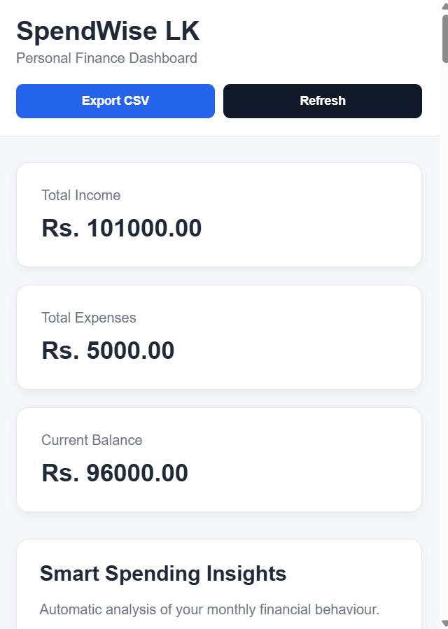
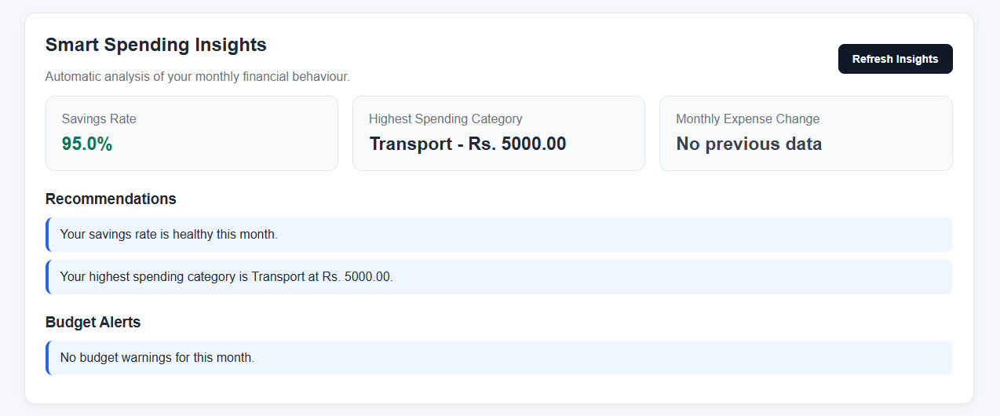
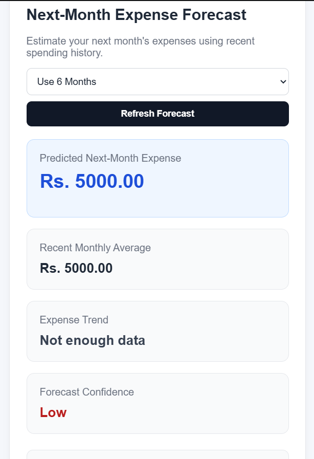
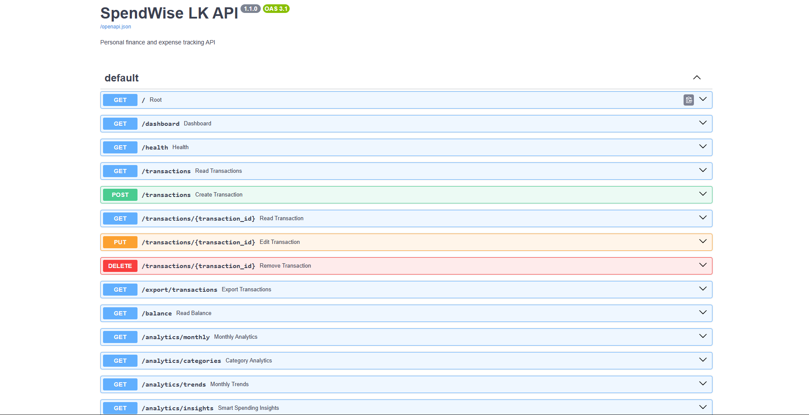

# SpendWise LK

SpendWise LK is a personal finance management web application built with Python, FastAPI, SQLite, HTML, CSS, and JavaScript.

The application helps users record income and expenses, monitor monthly budgets, track savings goals, manage recurring transactions, analyze spending behaviour, export transaction data, generate smart financial insights, and estimate future expenses.

## Features

- Add income and expense transactions
- Edit and delete transactions
- View transaction history
- View total income, total expenses, and current balance
- Monthly financial analytics
- Category-wise spending analysis
- Income vs expense charts
- Multi-month financial trend visualization
- Set monthly budgets by category
- Monitor budget usage and warnings
- Create and track savings goals
- Manage recurring monthly transactions
- Export transaction history as CSV
- Smart spending insights
- Savings rate calculation
- Highest spending category detection
- Month-to-month expense comparison
- Budget alerts and recommendations
- Next-month expense forecasting
- REST API with Swagger documentation
- Responsive finance dashboard

## Smart Spending Insights

SpendWise LK analyzes monthly financial activity and generates useful insights such as:

- Monthly savings rate
- Highest spending category
- Spending changes compared with the previous month
- Budget usage warnings
- Automatic spending recommendations

## Expense Forecasting

The application includes a simple statistical forecasting feature that estimates next month's expenses using recent monthly spending history.

The forecast uses:

- Recent monthly average expenses
- Recent spending trend
- Trend adjustment
- Confidence level based on available historical data

This feature is intended as a simple financial planning estimate and not as financial advice.

## Technology Stack

### Backend

- Python
- FastAPI
- Uvicorn
- Pydantic

### Database

- SQLite

### Frontend

- HTML
- CSS
- JavaScript
- Chart.js

### Development Tools

- Visual Studio Code
- Git
- GitHub

## Project Structure

```text
SpendWise-LK/
│
├── api.py
├── app.py
├── database.py
├── spendwise.db
├── README.md
├── requirements.txt
├── .gitignore
│
├── frontend/
│   ├── index.html
│   ├── style.css
│   └── script.js
│
└── docs/
    ├── dashboard-overview.png
    ├── smart-insights.png
    ├── expense-forecast.png
    └── swagger-api.png
```

## Screenshots

### Dashboard Overview



### Smart Spending Insights



### Expense Forecasting



### REST API Documentation


## Main API Endpoints

### General

```text
GET /
GET /health
GET /dashboard
```

### Transactions

```text
GET    /transactions
POST   /transactions
GET    /transactions/{transaction_id}
PUT    /transactions/{transaction_id}
DELETE /transactions/{transaction_id}
```

### Financial Summary

```text
GET /balance
```

### Analytics

```text
GET /analytics/monthly
GET /analytics/categories
GET /analytics/trends
GET /analytics/insights
GET /analytics/forecast
```

### Budgets

```text
GET  /budgets
POST /budgets
```

### Savings Goals

```text
GET    /savings-goals
POST   /savings-goals
GET    /savings-goals/{goal_id}
PUT    /savings-goals/{goal_id}
DELETE /savings-goals/{goal_id}
```

### Recurring Transactions

```text
GET    /recurring-transactions
POST   /recurring-transactions
GET    /recurring-transactions/{recurring_id}
PUT    /recurring-transactions/{recurring_id}
DELETE /recurring-transactions/{recurring_id}
```

### Export

```text
GET /export/transactions
```

## API Documentation

When the application is running, Swagger API documentation is available at:

```text
http://127.0.0.1:8000/docs
```

## Dashboard

The dashboard is available at:

```text
http://127.0.0.1:8000/dashboard
```

The dashboard includes:

- Financial summary cards
- Transaction management
- Monthly analytics
- Category analysis
- Financial charts
- Budget tracking
- Savings goals
- Recurring transactions
- Smart spending insights
- Expense forecasting
- CSV export

## Installation

### 1. Clone the repository

```bash
git clone https://github.com/UdariHirukirani8/spendwise-lk.git
```

### 2. Open the project folder

```bash
cd spendwise-lk
```

### 3. Create a virtual environment

```bash
python -m venv .venv
```

### 4. Activate the virtual environment

PowerShell:

```powershell
.\.venv\Scripts\Activate.ps1
```

### 5. Install dependencies

```bash
pip install -r requirements.txt
```

### 6. Start the FastAPI server

```bash
python -m uvicorn api:app --reload
```

### 7. Open the dashboard

```text
http://127.0.0.1:8000/dashboard
```

## Example Workflow

A user can:

1. Add monthly salary as income.
2. Record expenses such as food, transport, bills, or education.
3. Set monthly budgets.
4. Analyze spending by category.
5. View financial trends.
6. Create savings goals.
7. Manage recurring expenses such as rent or internet bills.
8. View smart financial recommendations.
9. Estimate next month's expenses.
10. Export transaction records as CSV.

## Future Improvements

- User authentication
- Multiple user accounts
- Cloud database support
- Advanced machine learning forecasting
- Automated recurring transaction processing
- PDF financial reports
- Email notifications
- Budget notifications
- More advanced data visualizations
- Mobile-friendly progressive web application
- Cloud deployment

## Project Goal

The goal of SpendWise LK is to combine software engineering and data analytics concepts in a practical personal finance application.

The project demonstrates:

- Python backend development
- REST API development
- SQLite database management
- CRUD operations
- Frontend development
- Data visualization
- Financial analytics
- Rule-based insight generation
- Simple statistical forecasting
- Git and GitHub version control

## Author

Developed by Udari as a personal software engineering and data science portfolio project.